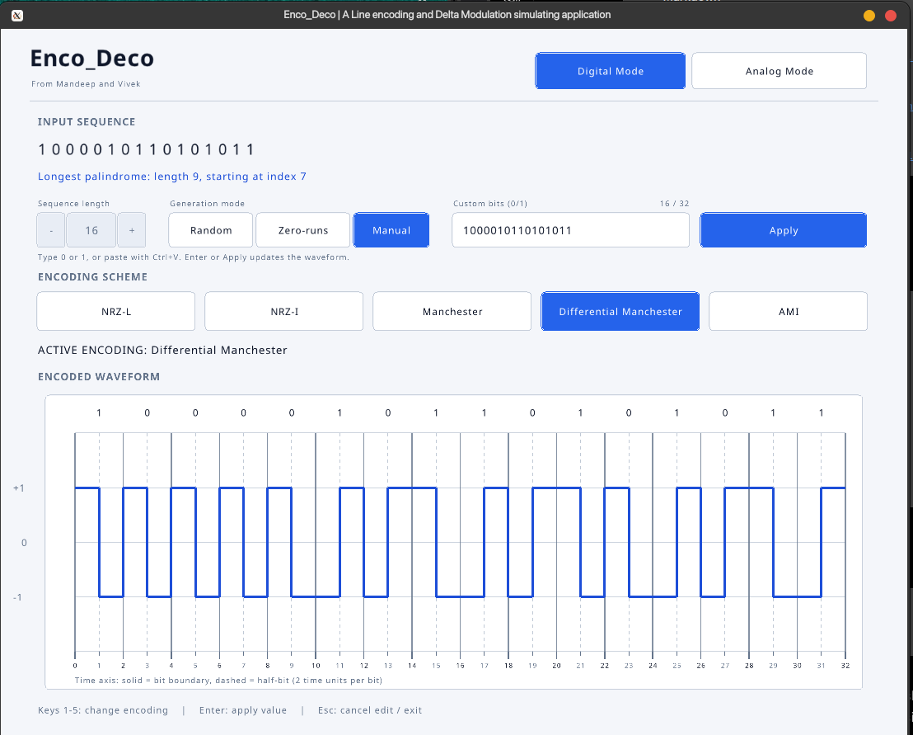
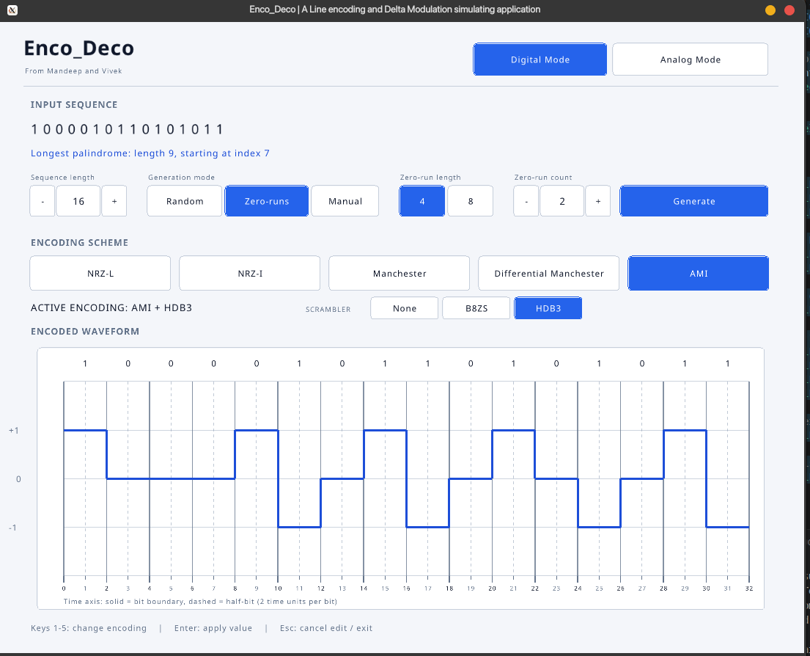
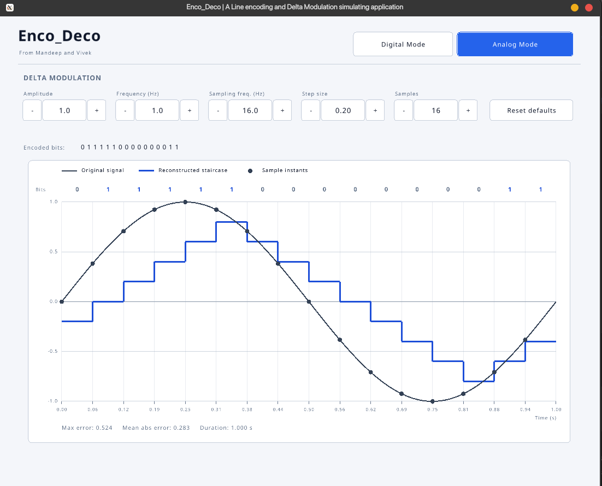

# Enco_Deco

**An interactive digital line-coding and delta-modulation visualizer built with C++17 and Raylib.**

Enco_Deco is a graphical application for exploring how binary data is represented as digital signals and how sampled analog signals can be encoded and reconstructed using delta modulation. Developed for **ITT 036 : Programming Assignment 1, Autumn 2026**, at the National Institute of Technology Srinagar.

## Features

### Digital Mode

- Generate random binary sequences.
- Generate sequences containing configured runs of four or eight consecutive zeros.
- Enter binary sequences manually.
- Find the **longest palindromic substring** using Manacher's algorithm in `O(n)` time.
- Encode bits using:
  - NRZ-L
  - NRZ-I
  - Manchester
  - Differential Manchester
  - Alternate Mark Inversion (AMI)
- Apply **B8ZS** or **HDB3** scrambling when AMI is selected.
- Visualize the resulting digital waveform.

### Digital Mode


### AMI Scrambling : B8ZS/HDB3


### Analog Mode : Delta Modulation

- Generate sine waves with configurable signal parameters.
- Sample the signal and encode it into a one-bit delta-modulation stream.
- Decode the bit stream into a staircase reconstruction.
- Visualize the original signal, sample points, reconstructed signal, and encoded bits.
- Inspect maximum absolute error and mean absolute error.
- Adjust signal and modulation parameters through the graphical interface.

### Analog Mode : Delta Modulation


## Technologies

| Technology | Purpose |
|---|---|
| C++17 | Application and algorithm implementation |
| [Raylib](https://www.raylib.com/) | Windowing, graphical interface, and plotting |
| [CMake](https://cmake.org/) | Project configuration and build system |
| CTest | Automated test execution |
| Git and GitHub | Version control and collaboration |

## Requirements

- A C++17-compatible compiler
- CMake
- Raylib development files and platform dependencies
- Git

### Linux : Fedora(used by Vivek)

Install the required tools and Raylib development files:

```bash
sudo dnf install gcc-c++ cmake git raylib-devel
```

Package availability may vary by Fedora version.

### Windows : VS Code and MSYS2(used by Mandeep)

1. Install [Visual Studio Code](https://code.visualstudio.com/).
2. Install [Git for Windows](https://git-scm.com/download/win).
3. Install [MSYS2](https://www.msys2.org/).
4. Open the **MSYS2 UCRT64** terminal and install the compiler, CMake, Ninja, and Raylib:

```bash
pacman -S --needed mingw-w64-ucrt-x86_64-gcc mingw-w64-ucrt-x86_64-cmake mingw-w64-ucrt-x86_64-ninja mingw-w64-ucrt-x86_64-raylib
```

5. Install Microsoft's **C/C++** extension in VS Code.
6. Use a terminal configured for the same MSYS2 UCRT64 environment. Ensure its `bin` directory is on `PATH`.

See the [official Raylib installation instructions](https://github.com/raysan5/raylib#installation) if the package is unavailable or additional setup is required.

### macOS

With Homebrew installed:

```bash
brew install cmake git raylib
```

Also install Apple's Xcode Command Line Tools if they are not already available.

## Build and Run

Clone the repository:

```bash
git clone https://github.com/Mandeep-pro/Enco_Deco.git
cd Enco_Deco
```

### Linux and macOS

Configure and compile:

```bash
cmake -S . -B build
cmake --build build --parallel
```

Run the application:

```bash
./build/bin/enco_deco
```

### Windows : VS Code with MSYS2 UCRT64

Run these commands in the MSYS2 UCRT64 terminal from the repository root:

```bash
cmake -S . -B build -G Ninja
cmake --build build --parallel
./build/bin/enco_deco.exe
```

Use the same MSYS2 toolchain for GCC, CMake, and Raylib. Mixing compilers or architectures can cause configuration or linking errors.

If the executable is not found, inspect the build output and the executable path configured by `CMakeLists.txt`.

## Run Tests

Run registered automated tests from the repository root.

**Linux and macOS:**

```bash
ctest --test-dir build --output-on-failure
```

**Windows:**

```bash
ctest --test-dir build --output-on-failure
```

CTest reports which tests pass and provides details for failures. Rebuild after source changes with:

```bash
cmake --build build --parallel
```

## Encoding Conventions

The application uses signal levels `+1`, `-1`, and `0`.

| Scheme | Convention |
|---|---|
| **NRZ-L** | `1` maps to `+1`; `0` maps to `-1`. |
| **NRZ-I** | `0` leaves the current level unchanged; `1` inverts it. Initial level: `+1`. |
| **Manchester** | `1` maps to `(-1, +1)` (low-to-high); `0` maps to `(+1, -1)` (high-to-low). |
| **Differential Manchester** | Every bit has a mid-bit transition. A `0` also causes a transition at the start of the bit; a `1` does not. Initial level: `+1`. |
| **AMI** | `0` maps to `0`; each `1` alternates between positive and negative pulses. The previous-pulse polarity starts at `-1`, so the first `1` is `+1`. |

### AMI Scrambling

B8ZS and HDB3 are applied on top of AMI to reduce long runs without transitions:

- **B8ZS** replaces eight consecutive zeros using a bipolar-violation substitution pattern.
- **HDB3** replaces four consecutive zeros using a substitution pattern selected according to polarity and parity rules.

## Design Notes and Assumptions

- Digital input is a binary sequence containing only `0` and `1`.
- The longest palindrome is a **substring**, not a subsequence.
- Digital waveforms use two half-bit samples per input bit.
- B8ZS and HDB3 are available as AMI scrambling options.
- Analog Mode uses a generated sine wave rather than external audio or sensor input.
- Delta modulation uses one-bit up/down decisions to reconstruct a staircase signal.
- The sine-wave frequency is constrained by `f < fs / 2`. This does not guarantee low reconstruction error.
- This is an educational visualization tool, not a physical communication-channel simulator.

## Project Structure

The code is organized into modules for sequence generation, palindrome detection, line encoding, AMI scrambling, analog signal generation, delta modulation, and graphical interface/rendering. CMake defines the application and automated test targets.

## References

- ITT 036, *Programming Assignment 1*, Autumn 2026, National Institute of Technology Srinagar.
- ITT 036 course lecture slides shared through Piazza.
- [LearnCpp](https://www.learncpp.com/)
- [CP-Algorithms : Manacher's Algorithm](https://cp-algorithms.com/string/manacher.html)
- [Raylib documentation](https://www.raylib.com/cheatsheet/cheatsheet.html)
- [CMake documentation](https://cmake.org/documentation/)

## Acknowledgment

AI tools were used as supplementary resources for understanding GUI development, resolving technical issues, and refining the build and testing workflow. The authors reviewed and integrated the resulting changes into the project.